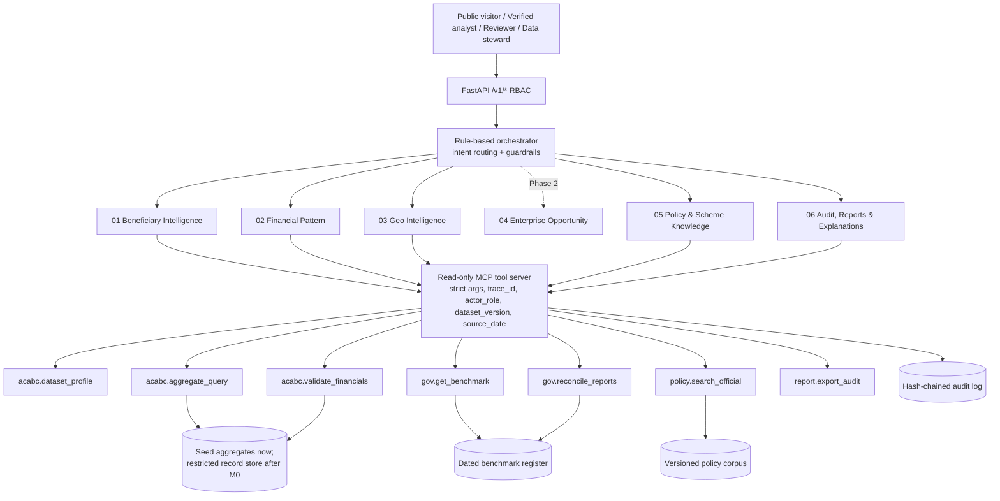

# Architecture

## Rules the code enforces

- **MCP is not the warehouse or the model.** It is the only door agents use. Agents contain no data access of their own.
- **Deny by default.** Unknown tool names, extra arguments (including anything SQL-like), unbounded filters and every role not on a tool's allow-list are rejected. There are no write or execute tools.
- **Every call** carries `trace_id`, `actor_role`, `dataset_version` and the source dates of what it returned, and is appended to a tamper-evident log.
- **Sources are distinct data products.** Each benchmark keeps agency, scope, reference date, unit and cumulative-vs-FY status. Differences are reported, never averaged. Incomparable pairs (different units, FY vs cumulative) return an inability-to-compare warning.
- **No fabricated dimensions.** A missing district or enterprise field blocks the view.
- **Suppression.** Ratios hide below 100 trained candidates. Public role hides positive counts below 10. Private aggregates hide cells below 10 for everyone but stewards.

## Agents

| # | Agent | V1 behaviour |
|---|---|---|
| 01 | Beneficiary Intelligence | MIS era split, state size tiers from aggregates; enterprise segments once the file maps `enterprise_type` |
| 02 | Financial Pattern | Subsidy per scheme with modified z-score (MAD); review ≥3.5, watch ≥1.5; low-count reliability flag; private group screen when data is loaded |
| 03 | Geo Intelligence | Concentration, FY subsidy geography, coverage diagnostics, k-means with bootstrap stability, silhouette and a plain-rule baseline |
| 04 | Enterprise Opportunity | Phase 2. Declines and lists prerequisites |
| 05 | Policy & Scheme Knowledge | BM25 retrieval, effective-date cutoff, supersession labels, abstains on rates/eligibility without an operative circular, injection-aware |
| 06 | Audit, Reports & Explanations | Evidence memo, discrepancy log, provenance appendix, artifact hash |

## Why a rule-based orchestrator

Routing is auditable and testable, and it cannot be argued out of its guardrails. An LLM may later phrase answers from agent output
(RAG for explanation only); it should never choose tools, data or roles.
